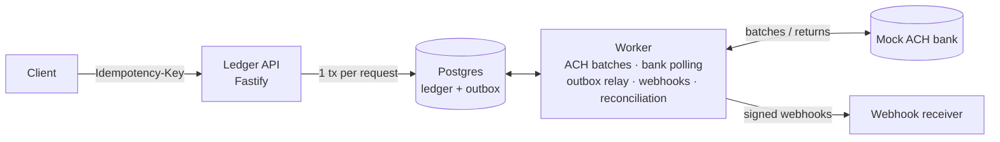

# payments-ledger

[](https://github.com/Dean998/payments-ledger/actions/workflows/ci.yml)

A double-entry ledger and ACH-style payments service in TypeScript and Postgres. It moves money
between wallets and to and from bank accounts, and it stays correct under retries, races, crashes
and bank returns.

**Highlights**

- **Double-entry accounting** with posted / pending / available balances, enforced **in the
  database** (deferred balance trigger, append-only lines) as well as in code.
- **Idempotent API**: idempotency keys committed in the _same transaction_ as the money movement.
  20 concurrent duplicate requests → exactly one transfer.
- **No overdrafts under concurrency**: ordered row locks. 50 parallel withdrawals against a
  balance of 1000 → exactly 33 succeed.
- **ACH lifecycle**: batching, settlement, early returns (R01) and _late_ returns after the money
  was spent (R10), with reversing entries.
- **Transactional outbox → signed webhooks** (Standard Webhooks spec), at-least-once delivery,
  leases, exponential backoff with jitter.
- **Continuous reconciliation** that re-derives every balance from immutable history and catches
  tampering.
- **Measured performance**: a k6 load test, a profiled bottleneck, and a 50× drop in median latency
  at 500 req/s from cutting DB round trips ([benchmarks](docs/benchmarks.md)).
- **AI-ready repo**: an agent guide, 5 task skills, guardrail hooks and a money-safety reviewer
  subagent ([how and why](docs/ai-workflow.md)).

## Architecture



The API only writes rows; it never calls the bank or a webhook inside a request. The worker does
all external I/O, claiming work with `FOR UPDATE SKIP LOCKED`, so it scales to N replicas. Full
write-up with requirements, capacity estimates, sequence diagrams and the scaling path:
**[docs/DESIGN.md](docs/DESIGN.md)**.

## Quick start

Needs Docker and Node 24.

```bash
docker compose up -d --build     # postgres, migrations, api :3000, worker, webhook sink :4000
npm install && npm run demo      # deposit → settle, transfer, withdrawal, R01 return, reconciliation
docker compose logs webhook-sink # signature-verified webhooks for every state change
```

Demo output:

```
▸ Alice deposits $500.00 by ACH pull. It is pending, not yet available
  Alice  posted     0.00 USD  pending   500.00 USD  available     0.00 USD
  …waiting for the worker to batch it and the mock bank to settle it
  Alice  posted   500.00 USD  pending   500.00 USD  available   500.00 USD

▸ Bob withdraws $50.00 by ACH push. The funds are held immediately
  Bob    posted   120.00 USD  pending    70.00 USD  available    70.00 USD

▸ Bob tries to deposit $100.01. The mock bank returns it with R01 (insufficient funds)
  withdrawal: settled; deposit: returned (R01)

▸ Run reconciliation: re-derive every balance from the entry lines
  status=ok accounts=5 discrepancies=0
```

The mock bank is deterministic: amounts ending in `.01` return R01, `.02` R02, `.03` R03; `.10`
settles and then gets a late R10 return; everything else settles after 10 s.

## API

| Method         | Path                                                  | Notes                                                                      |
| -------------- | ----------------------------------------------------- | -------------------------------------------------------------------------- |
| `POST`         | `/accounts`                                           | `{name, currency, normalBalance?, allowNegative?, metadata?}`              |
| `GET`          | `/accounts/:id`                                       | balances: `posted`, `pending`, `available` (minor units)                   |
| `GET`          | `/accounts/:id/lines?limit&before`                    | ledger history, cursor-paginated                                           |
| `GET`          | `/entries/:id`                                        | a journal entry and its lines                                              |
| `POST`         | `/transfers`                                          | **requires `Idempotency-Key`**. `type`: `book` \| `ach_push` \| `ach_pull` |
| `GET`          | `/transfers/:id`                                      |                                                                            |
| `GET`          | `/transfers/:id/events`                               | audit trail of state changes                                               |
| `POST`         | `/transfers/:id/cancel`                               | only while pending and not yet batched                                     |
| `POST`         | `/webhook-endpoints`                                  | `{url, eventTypes?}` → returns the signing secret once                     |
| `GET`          | `/webhook-endpoints/:id/deliveries`                   | delivery status, attempts, last error                                      |
| `POST` / `GET` | `/reconciliation/runs`, `/reconciliation/runs/latest` | run or read reconciliation                                                 |
| `GET`          | `/health`, `/metrics`                                 | Prometheus metrics (worker also on `:9464/metrics`)                        |

Errors are always `{"error": {"code": "insufficient_funds", "message": "…", "details": {…}}}`
with a stable `code`.

## Correctness, in layers

| Invariant                             | Service        | Database              | Reconciliation          |
| ------------------------------------- | -------------- | --------------------- | ----------------------- |
| Entries balance per currency          | ✓              | deferred trigger      | trial balance           |
| Lines immutable, posted entries final | ✓              | triggers              |                         |
| Balances = Σ lines                    | ✓              |                       | drift check             |
| Transfer status matches entry status  | ✓              |                       | consistency check       |
| No overdraft                          | under row lock | non-negative `CHECK`s | warning on late returns |

## Tests

59 tests: unit tests for the pure logic, and **integration tests against real Postgres** for
everything that involves concurrency or SQL guarantees:

- concurrent withdrawals, concurrent duplicate idempotency keys
- the database rejecting unbalanced entries and edits to history, even when the service is bypassed
- the ACH lifecycle with simulated time: settle, R01, late R10 after the money was spent, duplicate
  bank updates, a crashed batch upload
- outbox atomicity, webhook signing (against the spec's reference vector), retries and dead-lettering
- reconciliation catching tampered balances and statuses

```bash
docker compose up -d postgres && npm test   # ~5 s
```

[docs/failure-modes.md](docs/failure-modes.md) maps each failure scenario to the test that proves
the behaviour.

## Key decisions

- [0001](docs/adr/0001-fastify-and-sql-over-nestjs-and-orm.md) Fastify + raw SQL over NestJS + ORM
- [0002](docs/adr/0002-double-entry-with-materialised-balances.md) Materialised balances, invariants in the database
- [0003](docs/adr/0003-idempotency-in-the-same-transaction.md) Idempotency keys in the same transaction
- [0004](docs/adr/0004-postgres-outbox-before-kafka.md) Postgres outbox before Kafka
- [0005](docs/adr/0005-pending-posted-archived-entries.md) Pending entries instead of holds
- [0006](docs/adr/0006-row-locks-over-serializable.md) Ordered row locks over SERIALIZABLE
- [0007](docs/adr/0007-standard-webhooks-at-least-once.md) Standard Webhooks, at-least-once

## Performance

Laptop numbers, one API process ([methodology and caveats](docs/benchmarks.md)):

|                                                            | Median   | p95        |
| ---------------------------------------------------------- | -------- | ---------- |
| 500 req/s spread, before optimisation                      | 394 ms   | 1.24 s     |
| 500 req/s spread, after (17 → 12 round trips per transfer) | **8 ms** | **293 ms** |
| 150 req/s, all from one hot wallet                         | 9–12 ms  | 500–630 ms |

A single hot account tops out at ~150–200 transfers/s on one row lock. That's why the design
shards the settlement account ([DESIGN §9](docs/DESIGN.md#9-scaling-path)).

## Project layout

```
src/ledger          double-entry core: accounts, balances, entries
src/transfers       state machine, transfer service, routes
src/ach             bank interface, deterministic mock bank, batch/poll jobs
src/idempotency     runIdempotent
src/outbox          transactional outbox + relay
src/webhooks        signing, backoff, dispatcher
src/reconciliation  balance re-derivation and invariant checks
test/               unit + integration (real Postgres)
load/               k6 scenarios
docs/               design, ADRs, failure modes, benchmarks, AI workflow
.claude/            agent skills, hooks, reviewer subagent
```

## Not production-ready (on purpose)

No authentication (it belongs at the gateway), no real bank integration, no FX, no vault for
account numbers, and no replay endpoint for dead webhooks. Each is called out in the design doc
along with how it would be done.

## License

MIT
