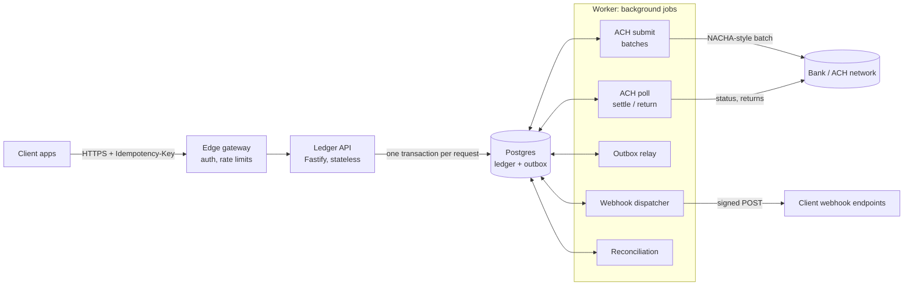
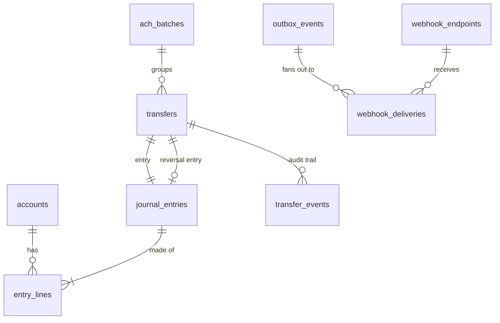
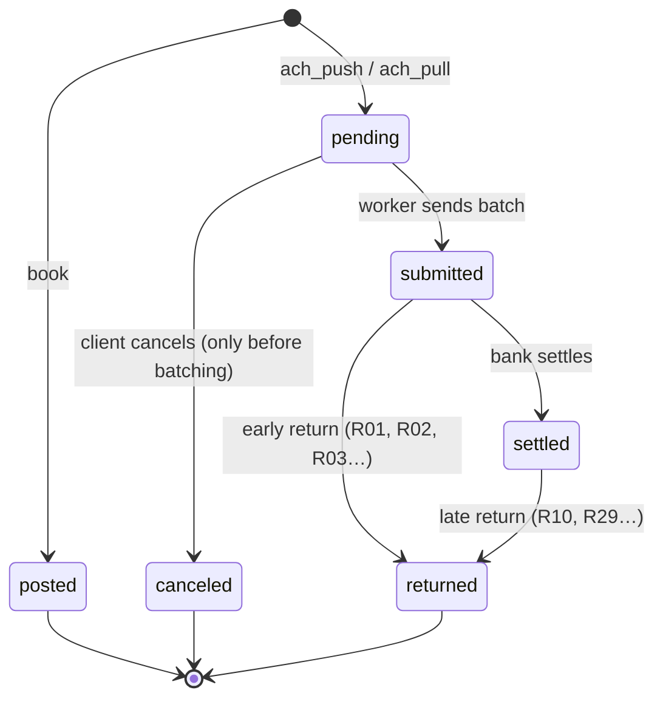

# Design: payments-ledger

A ledger service that holds customer balances and moves money between them, out to bank accounts
(ACH push) and in from bank accounts (ACH pull). This document covers what it must do, the numbers
it's sized for, how it stays correct, and how it would scale.

- [1. Requirements](#1-requirements)
- [2. Capacity estimates](#2-capacity-estimates)
- [3. Architecture](#3-architecture)
- [4. Data model](#4-data-model)
- [5. Money movement flows](#5-money-movement-flows)
- [6. Correctness](#6-correctness)
- [7. Delivering events: outbox and webhooks](#7-delivering-events-outbox-and-webhooks)
- [8. Reconciliation](#8-reconciliation)
- [9. Scaling path](#9-scaling-path)
- [10. Security and compliance notes](#10-security-and-compliance-notes)
- [11. Out of scope](#11-out-of-scope)

## 1. Requirements

**Functional**

- Open accounts (wallets) in a currency; read posted, pending and available balances.
- Book transfers between two wallets, which settle instantly.
- ACH push (withdraw to a bank account) and ACH pull (deposit from one), which settle days later
  and can be **returned**, including after settlement.
- Cancel an ACH transfer until it's sent to the bank.
- Notify clients of every state change by signed webhook.
- An audit trail for every transfer, and a ledger history for every account.

**Non-functional**

| Property     | Target                                                     | Why                                                   |
| ------------ | ---------------------------------------------------------- | ----------------------------------------------------- |
| Correctness  | No money created or destroyed, ever. Every entry balances. | It's a ledger.                                        |
| Idempotency  | Any POST can be retried safely with the same key           | Clients retry on timeouts; mobile networks are flaky. |
| Durability   | A committed transfer survives any single-process crash     | Standard for financial records.                       |
| Latency      | p99 < 250 ms for `POST /transfers` at expected peak        | Interactive app flows.                                |
| Availability | 99.95% for the API; workers can lag minutes without loss   | ACH itself is a batch system; webhooks are async.     |
| Auditability | Every balance can be re-derived from immutable history     | Regulators, disputes, debugging.                      |

## 2. Capacity estimates

Sized for a mid-size consumer fintech:

|                      | Estimate                                                      |
| -------------------- | ------------------------------------------------------------- |
| Wallets              | 2 M                                                           |
| Transfers / day      | 5 M (≈ 58/s average)                                          |
| Peak factor          | 10× → **≈ 600 transfers/s** at peak                           |
| Of which ACH         | ~20% → ≈ 120/s at peak, all touching the settlement account   |
| Rows per transfer    | 1 transfer + 1 entry + 2 lines + 1–4 events + 1–4 outbox rows |
| Storage per transfer | ≈ 3 KB including indexes                                      |
| Growth               | 5 M × 3 KB ≈ **15 GB/day ≈ 5.5 TB/year**                      |

What follows from the numbers:

- **One Postgres primary is enough for writes** at 600/s; each transfer is one short transaction.
  The API is stateless and scales horizontally. On a laptop, one Node process does roughly
  300–500 transfers/s (see [benchmarks](benchmarks.md)).
- **Storage needs a lifecycle.** Partition `entry_lines` and `journal_entries` by month. Keep the
  outbox and webhook deliveries for 7–30 days. Idempotency keys expire after 24 hours.
- **The settlement account is a hot row.** 120 ACH transfers/s all lock the same account. The
  hot-wallet benchmark shows one row tops out around 150–200 transfers/s locally. This is the
  first thing that breaks; see [§9](#9-scaling-path).

## 3. Architecture



Two processes share one database:

- **API**: validates requests, writes the ledger in a single transaction, returns. It never calls
  the bank or a webhook; it only writes rows.
- **Worker**: the loops that talk to the outside world. Each job claims work with
  `FOR UPDATE SKIP LOCKED`, so any number of worker replicas can run at once.

Rate limiting and authentication belong at the edge gateway (a separate Rust service in this
portfolio), not in the ledger.

## 4. Data model



- **accounts**: each has a normal balance (`credit` for wallets, which are liabilities to the
  platform; `debit` for the bank settlement account, an asset) and four materialised columns:
  `posted_debits`, `posted_credits`, `pending_debits`, `pending_credits`.
- **journal_entries**: `pending → posted | archived`. Posting or archiving is the only change
  allowed, enforced by a trigger.
- **entry_lines**: append-only. `(account, direction, amount)`. Lines in an entry balance per
  currency (deferred constraint trigger).
- **transfers**: the business object clients see, with a state machine
  ([`src/transfers/state.ts`](../src/transfers/state.ts)) and a pointer to its entry.

### Balances

| Balance   | Credit-normal formula                     | Meaning                                          |
| --------- | ----------------------------------------- | ------------------------------------------------ |
| posted    | `posted_credits − posted_debits`          | Settled money                                    |
| pending   | posted + pending credits − pending debits | Where it will be if everything in flight settles |
| available | posted − pending debits                   | What can be spent now                            |

Pending **outflows** reduce what's available straight away. Pending **inflows** don't count until
they settle. That asymmetry is the whole point: an incoming ACH pull can still bounce.

> Why materialise balances instead of `SUM()`-ing lines on every read? Reads and overdraft checks
> are O(1) and can be locked as one row. The cost is that the columns can drift if anything writes
> them outside the ledger code, which is why reconciliation re-derives them continuously. See
> [ADR 0002](adr/0002-double-entry-with-materialised-balances.md).

## 5. Money movement flows

### Entry shapes

| Transfer | On creation                                     | On settle      | On return                                                       |
| -------- | ----------------------------------------------- | -------------- | --------------------------------------------------------------- |
| book     | posted: Dr source wallet, Cr destination wallet | –              | –                                                               |
| ach_push | pending: Dr wallet, Cr settlement               | post the entry | before settle: archive the entry. After settle: posted reversal |
| ach_pull | pending: Dr settlement, Cr wallet               | post the entry | same as push                                                    |

### State machine



"Settled" is not final in ACH. Unauthorised-debit returns can arrive up to 60 days later for
consumer accounts. The ledger models that with a reversing entry rather than pretending the money
never moved.

### ACH pull, end to end

```mermaid
sequenceDiagram
  autonumber
  participant C as Client
  participant A as API
  participant DB as Postgres
  participant W as Worker
  participant B as Bank

  C->>A: POST /transfers (ach_pull, Idempotency-Key)
  A->>DB: BEGIN; idempotency key; lock accounts;<br/>transfer + pending entry + outbox event; COMMIT
  A-->>C: 201 {status: pending}
  Note over DB: wallet: pending +X, available unchanged

  W->>DB: claim unbatched transfers into batch (status created)
  W->>B: submit batch (idempotent on batch id)
  W->>DB: transfers → submitted; batch → sent
  W->>B: poll status
  B-->>W: settled
  W->>DB: lock transfer; post entry; → settled; outbox event
  Note over DB: wallet: posted +X, available +X
  W->>DB: relay outbox → webhook_deliveries
  W->>C: POST webhook (signed), retried until 2xx
```

## 6. Correctness

### Invariants and where they're enforced

| Invariant                      | Service code                            | Database                          | Reconciliation                  |
| ------------------------------ | --------------------------------------- | --------------------------------- | ------------------------------- |
| Entries balance per currency   | `createEntry`                           | deferred constraint trigger       | trial balance check             |
| Lines are immutable            | (no code path updates them)             | `BEFORE UPDATE OR DELETE` trigger | –                               |
| Posted entries are final       | `transitionEntry`                       | status guard trigger              | –                               |
| Balances = sum of lines        | `createEntry` / `transitionEntry` only  | –                                 | `balance_drift` check           |
| Transfer status ↔ entry status | `moveTransfer` + entry change in one tx | –                                 | `transfer_entry_mismatch` check |
| No overdraft (unless allowed)  | `assertNoOverdraft` under row lock      | `CHECK`s on non-negative columns  | `negative_balance` warning      |

Each critical invariant is enforced in at least two places, so a single bug can't silently break
it.

### Concurrency

Every transaction that changes balances **locks the affected account rows first, in sorted id
order**, using `SELECT … FOR NO KEY UPDATE`. Then it reads balances, decides, and writes. Because
everyone locks in the same order, two transfers can't deadlock on each other. Because the check
happens under the lock, two withdrawals can't both spend the same money. The test
"50 parallel withdrawals of 30 from a balance of 1000" asserts exactly 33 succeed.

Two details worth knowing:

- **`FOR NO KEY UPDATE`, not `FOR UPDATE`.** Inserting a row with a foreign key to an account takes
  a `FOR KEY SHARE` lock on that account, which conflicts with `FOR UPDATE`. With `FOR UPDATE`, two
  concurrent withdrawals deadlocked: each held KEY SHARE (from inserting its transfer row) and
  waited for the other's FOR UPDATE. The concurrency test caught this. `NO KEY UPDATE` doesn't
  conflict with key-share locks, and we never change account keys.
- **Why not `SERIALIZABLE`?** It would also be correct, but conflicts surface as aborts at commit.
  Under contention (one hot wallet) that turns into retry storms. Explicit row locks make
  contention queue instead of fail, and the lock order makes deadlocks impossible.
  [ADR 0006](adr/0006-row-locks-over-serializable.md).

### Idempotency

`POST /transfers` requires an `Idempotency-Key`. The key row is inserted **in the same transaction
as the transfer**:

1. `INSERT idempotency_keys … ON CONFLICT DO NOTHING`. A second request with the same key blocks
   on the unique index until the first transaction finishes.
2. If the insert did nothing, the key exists: compare the request hash (different body → 422) and
   replay the stored response with `Idempotent-Replayed: true`.
3. Otherwise run the business logic inside a savepoint, store the response, commit.

Business errors such as `insufficient_funds` are stored and replayed, as Stripe does. Unexpected
errors roll everything back so the client can retry. Because the key and the effect commit
together, there is no window where "the transfer exists but the key doesn't", or the reverse. See
[ADR 0003](adr/0003-idempotency-in-the-same-transaction.md).

The same idea applies inside the system: bank updates are applied under a row lock after
re-checking status, so duplicate or late updates are no-ops. ACH batches are recorded before
they're sent, so a crash mid-upload is retried with the same batch id.

## 7. Delivering events: outbox and webhooks

**Dual-write problem:** "commit to the DB, then publish an event" loses events if the process dies
between the two steps. "Publish, then commit" publishes events for things that never happened.

**Transactional outbox:** the event row is written in the same transaction as the state change. A
relay later moves unpublished events into per-endpoint `webhook_deliveries` rows. The outbox is
the single source of truth for "what happened".

**Dispatcher:**

- Claims due deliveries in one `UPDATE … RETURNING` that pushes `next_attempt_at` forward by a
  lease (30 s). No transaction is held open during the HTTP call. If the worker dies mid-send, the
  lease expires and another worker retries.
- At-least-once delivery. Receivers dedupe on the `webhook-id` header (the event id).
- Exponential backoff with jitter, about 8 attempts over ~2 minutes in dev (configurable), then the
  delivery is marked `dead`.
- Signatures follow the [Standard Webhooks](https://www.standardwebhooks.com/) spec
  (`v1,` HMAC-SHA256 over `id.timestamp.body`); a unit test checks the spec's reference vector.
- Events carry a `sequence` (the outbox id). Retries mean deliveries can arrive out of order, so
  receivers use it to ignore stale updates for the same transfer.

Why not Kafka? At this scale Postgres polling with `SKIP LOCKED` adds a few hundred ms of latency
and zero new infrastructure. The trigger to revisit is in
[ADR 0004](adr/0004-postgres-outbox-before-kafka.md).

## 8. Reconciliation

A worker job re-derives every account's four balance columns from the immutable lines, in a single
`REPEATABLE READ` snapshot (so concurrent writes can't cause false alarms), and checks:

1. **Balance drift**: stored columns vs. the sum of lines.
2. **Trial balance**: posted debits = posted credits per currency, across the whole ledger.
3. **Transfer ↔ entry consistency**: e.g. a `settled` transfer must have a `posted` entry.
4. **Negative balances** on accounts that shouldn't go negative. Reported as a warning, because a
   late return makes this legitimately possible.

The tests tamper with balances and statuses directly in SQL and assert reconciliation catches each
case. At production scale this becomes incremental: checkpointed per-account sums plus a daily
full pass over the previous day's partition, alongside reconciliation against the bank's
settlement files.

## 9. Scaling path

In the order things would break:

1. **API CPU.** Single Node process ≈ 300–500 transfers/s locally. Run N replicas behind the
   gateway; the API is stateless. Use PgBouncer in transaction mode in front of Postgres once
   replicas × pool size gets close to `max_connections`.
2. **Hot settlement account.** Shard it into 16 sub-accounts (`bank:USD:0..15`), pick one by
   hashing the transfer id, and sum them for reporting. Lock contention drops about 16×. The same
   trick applies to any hot merchant wallet.
3. **Round trips per transfer.** Already cut from 17 to 12 ([benchmarks](benchmarks.md)). Next:
   prepared statements, and moving the transfer + entry + lines + outbox insert into one
   PL/pgSQL function (one round trip, though harder to test and change).
4. **Storage.** Monthly partitions for lines and entries; detach and archive old partitions to
   object storage; short TTLs on the outbox and deliveries.
5. **Outbox throughput.** Swap polling for logical replication (Debezium → Kafka) when lag p99
   exceeds a few seconds or other consumers need the event stream.
6. **Beyond one primary.** Shard by account id. Cross-shard transfers then need a two-phase flow
   through a clearing account, the same shape as an ACH transfer. That's why the pending/posted
   model is worth having from day one.

## 10. Security and compliance notes

- Full bank account numbers are stored in their own column and never serialised; responses
  show the last four digits only. In production this would be a token from a vault (PCI DSS-style
  segmentation, NACHA data security rules).
- Routing numbers are checksum-validated at the API to avoid avoidable R03/R04 returns.
- Webhook secrets are shown once, at creation. Signatures carry a timestamp to limit replays.
- Authentication, authorisation and rate limiting are delegated to the gateway; the ledger trusts
  its network boundary in this design.

## 11. Out of scope

FX and multi-currency transfers, card payments, holds/authorisations with expiry, fees,
statements, KYC, and a real bank integration. The `AchNetwork` interface is the seam where a
real one would plug in.
